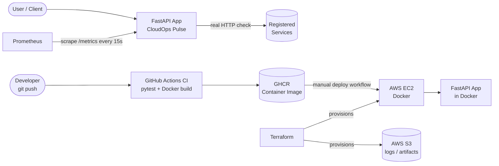

# CloudOps Pulse

[](https://github.com/anshchaudhary289-prog/cloudops-pulse/actions/workflows/ci.yml)


**A production-style service uptime & health monitoring API with a complete DevOps pipeline — tests, Docker, CI/CD, Prometheus monitoring, and Terraform deployment to AWS.**

Register any HTTP service, check it on demand, and get status, latency and uptime — with Prometheus metrics, alert rules, and an infrastructure-as-code path to a real cloud deployment.

---

## What it does

- **Service registry** — register / list / inspect / delete services you want to monitor (`name` + `url`)
- **Real health checks** — performs an actual HTTP request (3-second timeout), measures latency, classifies up/down, and handles unreachable services gracefully instead of crashing
- **Uptime tracking** — keeps check history per service and calculates uptime %
- **Prometheus metrics** — `/metrics` in Prometheus text format, implemented manually (no extra library) so the format is understood, not just imported
- **Production packaging** — multi-stage Dockerfile (non-root user, `HEALTHCHECK`), docker-compose stack with Prometheus, GitHub Actions CI, manual GHCR deploy, and Terraform for AWS EC2 + S3

## Architecture



## Tech stack

| Area | Technology |
|---|---|
| API | Python 3.12, FastAPI, Uvicorn |
| Health-check logic | Pure Python (`app/checker.py`), stdlib `urllib` |
| Tests | pytest, FastAPI `TestClient` (httpx) |
| Container | Docker (multi-stage, non-root), docker-compose |
| Monitoring | Prometheus, custom metrics, alert rules |
| CI/CD | GitHub Actions — CI on push/PR, manual deploy to GHCR (+ optional SSH) |
| Infrastructure | Terraform (AWS provider ~> 5.0) — EC2, Security Group, S3 |
| Cloud | AWS `ap-south-1` (Mumbai), `t2.micro`, Ubuntu 22.04 AMI |

## Quickstart

### 1. Local Python

```bash
git clone https://github.com/anshchaudhary289-prog/cloudops-pulse.git
cd cloudops-pulse

python -m venv .venv
source .venv/bin/activate        # Windows: .venv\Scripts\activate

pip install -r requirements-dev.txt
uvicorn app.main:app --reload --port 8000
```

Open http://localhost:8000/docs for the interactive API docs.

Run the tests:

```bash
pytest -q
```

### 2. Docker Compose (app + Prometheus)

```bash
docker compose up --build -d
./scripts/health-check.sh

# App:        http://localhost:8000
# Prometheus: http://localhost:9090
docker compose down
```

### Try it

```bash
curl http://localhost:8000/health

curl -X POST http://localhost:8000/api/services \
  -H "Content-Type: application/json" \
  -d '{"name": "example", "url": "https://example.com"}'

curl http://localhost:8000/api/services/example/check
curl http://localhost:8000/metrics
```

## API

| Method | Endpoint | Description |
|---|---|---|
| `GET` | `/` | Service info, version and links |
| `GET` | `/health` | Health, uptime seconds, version (used by Docker `HEALTHCHECK`) |
| `GET` | `/metrics` | Prometheus text metrics |
| `GET` | `/api/services` | List registered services with uptime % |
| `POST` | `/api/services` | Register a service — `{ "name": "...", "url": "https://..." }` (201, 409 on duplicate) |
| `GET` | `/api/services/{name}` | Get one service |
| `DELETE` | `/api/services/{name}` | Remove a service (204) |
| `GET` | `/api/services/{name}/check` | Real HTTP check — status, status code, latency, uptime % |

## CI/CD flow

- **CI** (`.github/workflows/ci.yml`) — on every push and pull request to `main`:
  setup Python 3.12 → install dev dependencies → Ruff lint → `pytest` → Docker build (no push, with GitHub Actions cache)
- **Deploy** (`.github/workflows/deploy.yml`) — **manual only** (`workflow_dispatch`):
  build & push the image to **GHCR** (`ghcr.io`) using `GITHUB_TOKEN`, then an optional SSH deploy step that runs `scripts/deploy.sh` on the target host. The SSH job is guarded by a repository variable, so it skips cleanly when secrets are not configured.

## Terraform — deploy to AWS

Provisions a security group (22 / 80 / 8000), an Ubuntu EC2 instance whose `user_data` installs Docker and runs the container, and a private, versioned, encrypted S3 bucket for logs/artifacts.

```bash
cd terraform
terraform init
terraform plan
terraform apply

terraform output app_url
# -> http://<public-ip>:8000
```

> Requires AWS credentials configured locally (for example via `aws configure`). Default region is `ap-south-1` and the default instance type is the free-tier-friendly `t2.micro` — see `terraform/variables.tf`. Run `terraform destroy` when done to avoid charges. See also the design notes in [`docs/ARCHITECTURE.md`](docs/ARCHITECTURE.md).

## Project structure

```
cloudops-pulse/
├── app/
│   ├── main.py            # FastAPI app, routes, metrics, real HTTP checks
│   └── checker.py         # Pure classification / latency / uptime logic
├── tests/                 # pytest — API tests + checker unit tests
├── monitoring/
│   ├── prometheus.yml     # Scrape config
│   └── alerts.yml         # ServiceDown / HighErrorRate rules
├── .github/workflows/
│   ├── ci.yml             # Test + lint + Docker build on push/PR
│   └── deploy.yml         # Manual: build & push to GHCR (+ optional SSH)
├── terraform/             # AWS EC2 + SG + S3 (versions/variables/main/outputs)
├── scripts/
│   ├── deploy.sh          # docker compose pull/up + health wait
│   ├── health-check.sh    # curl /health with retries
│   └── user_data.sh       # EC2 bootstrap: install Docker, run container
├── docs/ARCHITECTURE.md   # Design decisions and trade-offs
├── Dockerfile             # Multi-stage, non-root, HEALTHCHECK
├── docker-compose.yml     # App + Prometheus
├── pyproject.toml       # Project metadata, Ruff + pytest config
├── requirements.txt
└── requirements-dev.txt
```

## What I learned / interview talking points

- **Why multi-stage Docker?** Build dependencies stay in the builder stage — the runtime image is smaller, starts faster, and has a smaller attack surface. Running as a non-root user and adding a `HEALTHCHECK` are small choices that matter in production.
- **Why implement `/metrics` manually?** Using the Prometheus client library is fine, but writing the exposition format by hand taught me exactly what a counter vs a gauge is and what Prometheus actually scrapes.
- **Check logic is separated from I/O.** All classification and uptime maths lives in `app/checker.py` with no network calls, so it is fully unit-testable. The endpoint is a thin layer that does I/O and delegates decisions.
- **Graceful failure is a feature.** A monitored service being down is normal data, not an exception — unreachable checks return `status: down` with latency and an error string, never a 500 from the monitor itself.
- **CI vs CD are deliberately different.** CI runs automatically on every push; deployment is manual-only, because an automatic production deploy is a decision, not a default.
- **Terraform trade-offs.** This is a single-instance deployment on purpose — cheap, free-tier friendly, and easy to reason about. I can explain exactly what I would add for high availability (ALB + Auto Scaling, remote state in S3 + DynamoDB locking) and why I did not start there.
- **Known limitation, stated honestly:** the registry is in-memory, so state resets on restart. The next step is a repository interface with SQLite/Postgres behind it.

## Author

**Ansh Chaudhary** — Final-year B.Tech CSE student, targeting Cloud / DevOps internships.

- LinkedIn: https://www.linkedin.com/in/ansh-chaudhary-cse
- GitHub: https://github.com/anshchaudhary289-prog

## License

MIT — see [LICENSE](LICENSE).
